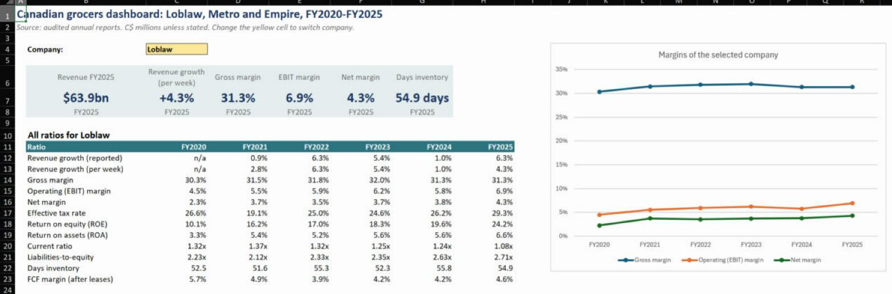
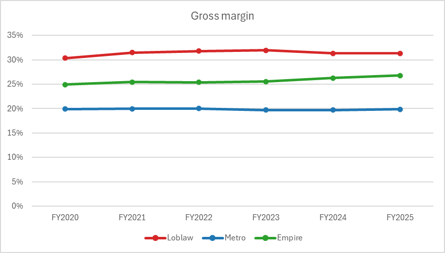
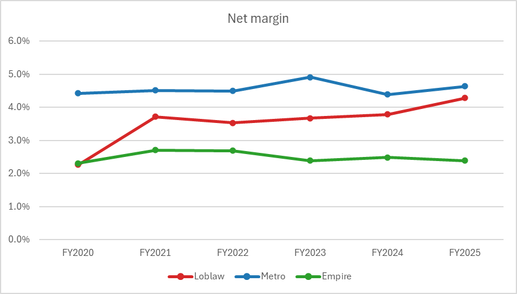
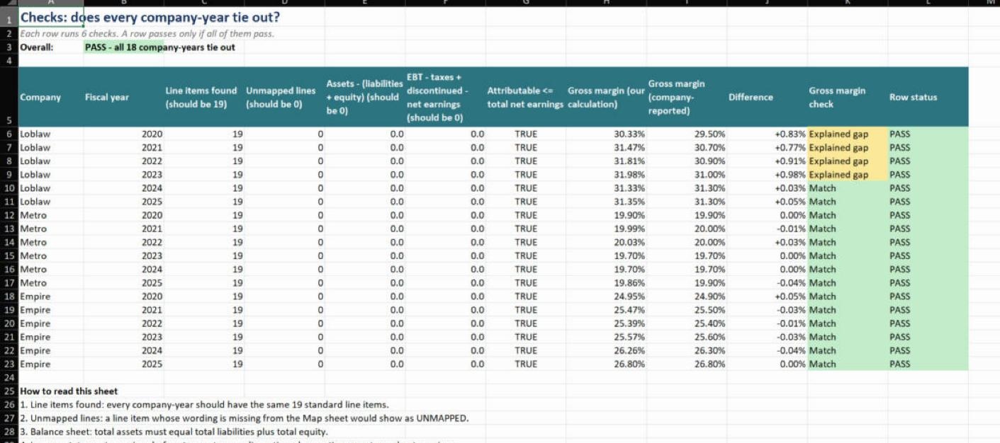

# Canadian Grocers Financial Analysis (Excel)

How profitable are Canada's three big grocers, and did their margins jump during the 2022–2023 food inflation?
This Excel workbook compares **Loblaw**, **Metro** and **Empire (Sobeys)** over six fiscal years (FY2020–FY2025),
using 342 figures from their audited annual reports.

## Short answer

There is no sign of a big margin jump. Between FY2021 and FY2023, when food inflation was highest, gross margins
moved by about half a percentage point or less, and net margins stayed between 2.4% and 4.9%. Profits in dollars
rose mainly because sales rose.

| | Loblaw | Metro | Empire |
|---|---|---|---|
| Gross margin FY2021 → FY2023 | 31.5% → 32.0% | 20.0% → 19.7% | 25.5% → 25.6% |
| Net margin FY2021 → FY2023 | 3.7% → 3.7% | 4.5% → 4.9% | 2.7% → 2.4% |
| Net margin FY2025 | 4.3% | 4.6% | 2.4% |
| Days inventory FY2025 | 55 | 33 | 29 |

  
  

## Other findings

- **Three different business models.** Loblaw has the highest gross margin (31.3% in FY2025), which fits its large
  pharmacy and beauty business, but also the highest costs. Metro has the lowest gross margin (19.9%) but an operating
  margin of 6.7%, close to Loblaw's 6.9% and well above Empire's 4.1%.
- **Empire's gross margin gains were absorbed by higher costs.** Its gross margin rose from 24.9% to 26.8% over six
  years, while its operating margin went from 4.2% to 4.1%.
- **Leases matter for cash flow.** Loblaw paid $1.3bn of lease principal in FY2025, about 20% of its operating cash
  flow. In FY2025, free cash flow after capex and lease payments was 2.6%–4.6% of sales across the three companies.
- **Loblaw's return on equity more than doubled** (10.1% → 24.2%) as earnings grew and share buybacks kept equity
  flat at about $11bn.

The full write-up, including the limits of the data, is on the **Findings** sheet.

## What is in the workbook

| Sheet | What it does |
|---|---|
| Dashboard | Key figures, a 12-ratio table for the company picked from a drop-down, and five charts |
| Findings | Conclusions and the limits of the analysis |
| Ratios | 12 ratios × 3 companies × 6 years, all formulas |
| Model | 19 standard line items per company, pulled from the Data table with `SUMIFS` |
| YoY | Year-over-year changes, with changes of 10%+ highlighted and explained from the MD&A |
| Forecast | FY2026 projection under low / base / high scenarios built from the last three years |
| Pivot | Two PivotTables with slicers and a PivotChart |
| Checks | Tie-out checks for every company-year (see below) |
| Data | Every figure with its source document and PDF page |
| Map | How each company's wording ("Revenue", "Sales", "Cost of merchandise inventories sold"…) maps to one standard line item, used by `XLOOKUP` |
| Periods | Fiscal year ends, 53-week years and the gross margins the companies report themselves |

**Excel features used:** Excel Tables and structured references, `XLOOKUP`, `SUMIFS`, `COUNTIFS`, `IF`/`AND`,
data-validation drop-downs, conditional formatting, PivotTables, slicers, PivotCharts and line/column charts.

## Making the numbers comparable

The three companies report differently, so the raw figures needed work before they could be compared:

- **Different wording.** The same item has different names in each report. The Map sheet sends every label to one
  of 19 standard line items. Metro's 2021 income statement combines cost of sales with operating expenses, so its
  cost of sales comes from the notes.
- **Different fiscal years.** Loblaw's year ends around December, Metro's in September and Empire's in May.
- **53-week years.** Loblaw FY2020 and FY2025, Metro FY2023 and Empire FY2022 have 53 weeks. A per-week revenue
  growth ratio removes the extra week.
- **A bank inside a grocer.** Loblaw's figures for FY2020–FY2023 include PC Financial, its bank. In the 2025 report
  PC Financial became a discontinued operation and FY2024 was restated without it.

## Checks

Every company-year passes six checks: all 19 line items present, no unmapped labels, assets = liabilities + equity,
earnings before tax − tax + discontinued operations = net earnings, attributable earnings ≤ total earnings, and
gross margin matching the figure each company reports in its MD&A. The only gaps are Loblaw FY2020–FY2023, where
Loblaw's own gross margin leaves out PC Financial; from FY2024, when PC Financial is excluded from both, the figures
match. Every typed-in figure was also checked against the text of the cited report page.

## Sources

Audited consolidated financial statements and MD&A in the 2021, 2023 and 2025 annual reports of
[Loblaw Companies Limited](https://www.loblaw.ca/en/investors-reports),
[Metro Inc.](https://www.corpo.metro.ca/en/investor-relations/financial-information/annual-reports.html) and
[Empire Company Limited](https://www.empireco.ca/annual-documents). Each report gives two fiscal years, and the
most recent report for each year is used, so restated figures are used where they exist.

## Files

- `Canadian_Grocers_Financial_Analysis.xlsx`: the workbook
- `data/line_items.csv`: the 342 source figures with document and page references
- `docs/images/`: screenshots and charts used in this README

This is a learning project, not investment advice.

**Author:** Duoming Yuan, University of Waterloo (Honours Mathematics)
